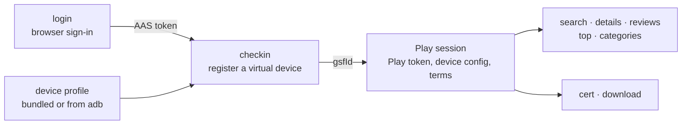

<h1 align="center">
  
</h1>

<p align="center">
  <strong>An unofficial Google Play Store client for the command line.</strong><br>
  Search apps, read reviews and top charts, check official signing certificates, and download APKs.
</p>

<p align="center">
  <a href="https://pypi.org/project/playstore-cli/"></a>
  
  <a href="LICENSE"></a>
</p>

> [!WARNING]
> This is a research and learning project that talks to Google Play's unofficial internal API. It may go against
> Google's terms of service, and the account you use may get restricted, so use a separate account.
> See [Caveats](#caveats).

<p align="center">
  
</p>

## Contents

- [Features](#features)
- [Installation](#installation)
- [Quick start](#quick-start)
- [How it works](#how-it-works)
- [Commands](#commands)
- [Storage](#storage)
- [Play API behavior confirmed against real responses](#play-api-behavior-confirmed-against-real-responses)
- [Development](#development)
- [Caveats](#caveats)
- [References](#references)
- [License](#license)

## Features

- **Sign in with your Google account.** A browser window handles the sign-in, 2-step verification included, and the long-lived token is stored locally.
- **Search, details and permissions.** Find package names and see versions, install counts and the permissions Play reports for your device.
- **Ratings and reviews.** The rating summary with its per-star distribution, plus reviews with developer replies, sorted by relevance or date.
- **Top charts.** Top free, top paid, top grossing and trending, for any category.
- **Official signing certificates.** The SHA-1 and SHA-256 Play reports for an app, optionally checked against the signing block of the APK it actually serves, by fetching only the end of the file.
- **APK downloads.** Base and split APKs and OBBs, verified against Play's hashes, ready for `adb install-multiple`. Older versions too, while Play still has them.
- **Your own device profiles.** Generate a profile from any Android phone over adb, so Play serves the same apps and builds as it would to that phone.

## Installation

Requires Python 3.10+. Install it as a command-line tool with [uv](https://docs.astral.sh/uv/) or [pipx](https://pipx.pypa.io/), which keep it in an environment of its own (uv also fetches a newer Python if yours is too old):

```bash
uv tool install playstore-cli
# or
pipx install playstore-cli
```

To try it without installing, run it with `uvx`. The sign-in is saved in `~/.config/playstore-cli` (see [Storage](#storage)), not in uvx's environment, so it carries over to later runs and to an installed copy:

```bash
uvx playstore-cli login
uvx playstore-cli checkin
uvx playstore-cli search youtube
```

Or with pip, preferably in a virtual environment:

```bash
python3 -m venv .venv          # Python 3.10 or newer
source .venv/bin/activate      # Windows: .venv\Scripts\activate
pip install playstore-cli
```

> [!NOTE]
> `No matching distribution found for playstore-cli` means pip is running on a Python older than 3.10.
> Check with `pip --version`, then use the pip of a newer Python, for example `python3.12 -m pip install playstore-cli`.

From a clone of this repository:

```bash
uv tool install .
```

You also need:

- A Chrome-based browser (Chrome, Chromium, Edge, Brave), used by `login`. Without one, `login` walks you through signing in with any desktop browser instead
- A Google account. A separate account for research is recommended (see [Caveats](#caveats))
- [adb](https://developer.android.com/tools/adb), only to generate your own device profiles with `profile`

## Quick start

```bash
playstore-cli login                                # 1. Google sign-in → AAS token
playstore-cli checkin                              # 2. register a virtual device → gsfId
playstore-cli search youtube                       # find package names
playstore-cli top Finance                          # top chart of a category (top free)
playstore-cli details com.google.android.youtube   # details and permissions
playstore-cli reviews com.google.android.youtube   # ratings and reviews
playstore-cli cert com.google.android.youtube      # official signing certificate hashes
playstore-cli download com.google.android.youtube  # download the APKs
```

`login` and `checkin` are needed only once. A Play session is created whenever needed, and when the Play token expires (401) it is rebuilt from the saved AAS token and the request is retried.

## How it works



1. `login` gets a one-time `oauth_token` from Google's "Add account" page and exchanges it for an AAS token at `android.clients.google.com/auth`.
2. `checkin` registers a virtual device, described by a device profile, and gets its gsfId.
3. A Play session (Play token, uploaded device configuration, accepted terms of service) is built from those two, then every command calls the Play Store's internal API (`android.clients.google.com/fdfe/…`) as that device.

## Commands

| Command | What it does |
|---|---|
| `login` | Sign in to a Google account → save an AAS token |
| `checkin` | Register a virtual device → save its gsfId |
| `profile` | Generate a device profile from an Android device or emulator over adb |
| `session` | Create a Play session (normally created automatically) |
| `search <query>` | Search apps |
| `top [category]` | Top charts by category (top free/paid, top grossing, trending) |
| `categories` | Category IDs and names |
| `details <package>` | App details and permissions |
| `reviews <package>` | Rating summary and reviews |
| `cert <package>` | SHA-1 and SHA-256 of the official signing certificates |
| `download <package>` | Download the base and split APKs and OBBs |

### login

```bash
playstore-cli login [--email EMAIL] [--manual] [--oauth-token TOKEN] [--timeout 600]
```

- Opens the Google "Add account" page (`accounts.google.com/EmbeddedSetup`) in a browser window. Once you have signed in (including 2-step verification), it reads the `oauth_token` cookie and exchanges it for a long-lived AAS token. The window closes by itself.
- It looks for Chrome, Chromium, Edge and Brave in their usual places on macOS, Linux and Windows. On Windows, Edge comes with the system.
- The browser profile used for the login is kept, so 2-step verification is usually asked only the first time.
- With `--manual`, or when no Chrome-based browser is found, it prints the steps to sign in with any desktop browser and copy the `oauth_token` cookie from its developer tools, then asks you to paste it. A phone browser won't do, since it can't show cookies.
- With `--oauth-token`, the token is taken from the command line instead. It expires within minutes, so use it right away.

### checkin

```bash
playstore-cli checkin [--profile NAME_OR_PATH] [--locale en_US] [--timezone UTC] [--force]
```

- Registers a virtual device with Google and gets its gsfId. All later Play requests are made as this device.
- `--profile` is the device it pretends to be: a profile name (your own profiles in `~/.config/playstore-cli/profiles/` come first, then the bundled ones) or a path to a `.properties` file. The default, `galaxy_s10e`, is a Samsung Galaxy S10e (SM-G970N) on Android 12, generated with [profile](#profile) and without operator codes. Play serves apps and builds that fit the profile's Android version, so make a profile of a newer phone for apps that need a newer Android.
- Play answers in the device locale (app titles, install counts, category names). Prices are in the currency of the account's country.
- Every checkin adds a new device to the account, so an already registered device is reused. Pass `--force` to register a new one.

### profile

```bash
playstore-cli profile [-s SERIAL] [--name NAME] [-o FILE]
```

```
Reading the device over adb...
Google sdk_gphone64_arm64, Android 15 (SDK 35)
  google/sdk_gphone64_arm64/emu64a:15/AE3A.240806.043/12960925:userdebug/dev-keys
Saved: ~/.config/playstore-cli/profiles/emu64a.properties
Use it: playstore-cli checkin --profile emu64a --force
```

- Reads a device profile from an Android phone or emulator connected over [adb](https://developer.android.com/tools/adb) (USB debugging on): build properties (`getprop`), the screen, input, features, shared libraries and GL extensions (`am get-config --device`, the same data the Play Store uploads), the Google Play services and Play Store versions, and the system locales (from the resources of `framework-res.apk`).
- Saves it as `~/.config/playstore-cli/profiles/<Build.DEVICE>.properties`, ready for `checkin --profile`.
- The device decides which APK variants Play serves. Emulator images without Google Play are test-key builds (`userdebug/dev-keys`), and Play gives them differently signed variants of some apps, Google's own in particular (see [cert](#cert)). Use a real phone, or an emulator image with Google Play, to get the variants regular phones get.
- If the device has no real Play Store (emulator images without Google Play ship a stub), a current Play Store version is filled in, because Play rejects very old ones.

### search

```bash
playstore-cli search youtube [-n 20]
```

```
  1. YouTube — Google LLC
     com.google.android.youtube · 21.32.4 · 10,000,000,000+ downloads · Free
  2. LINE: Calls & Messages — LINE (LY Corporation)
     jp.naver.line.android · 26.15.1 · 1,000,000,000+ downloads · Free
```

- Pages through the results and collects up to `-n` apps without duplicates, until Play stops returning more ("youtube" ends at 516).
- Play returns popular apps even for a query with no match.

### top

```bash
playstore-cli top [category] [-c free|paid|grossing|trending] [-n 20]
```

```
$ playstore-cli top GAME -c paid -n 3
GAME Top paid
  1. Dungeon Merge! — Brilbox
     com.brilbox.dungeonmerge · 1.0.41 · ₩70
  2. Minecraft: Dream it, Build it! — Mojang
     com.mojang.minecraftpe · 1.26.52.3 · ₩9,900
  3. Stardew Valley — ConcernedApe
     com.chucklefish.stardewvalley · 1.6.15.3 · ₩5,900
```

- The category is an ID (`FINANCE`, `GAME_PUZZLE`; any case if it has an underscore) or a name as `categories` prints it (`Finance`, `Puzzle`, `Health & Fitness`; any case). Without one, the chart covers all apps (`APPLICATION`). Names shared by several categories (`Sports` = `SPORTS`, `GAME_SPORTS`) need the ID.
- `-c`: `free` top free (default), `paid` top paid, `grossing` top grossing, `trending` trending.
- Ranks come 7 at a time and are collected up to `-n`. Play goes to about rank 200 (Finance top free ends at 197, in about 5 seconds). Charts with few apps are shorter (top paid in Finance has 1).
- Top chart responses carry no install count, so it is left out of the output.

### categories

```bash
playstore-cli categories
```

```
APPLICATION              Apps
  ANDROID_AUTO_PROJECTED Android Auto
  ...
  FINANCE                Finance
  ...
GAME                     Games
  GAME_ACTION            Action
  ...
```

- The category IDs and names to pass to `top`. Names come in the device locale (35 app and 17 game categories).

### details

```bash
playstore-cli details com.google.android.youtube
```

```
Title        YouTube
Package      com.google.android.youtube
Version      21.32.4 (1561190505)
Developer    Google LLC
Updated      Aug 10, 2026
Installs     10,000,000,000+ downloads
Size         137.3 MB
Permissions  51
  android.permission.ACCESS_ADSERVICES_AD_ID
  ...
```

The permission list is not the manifest as-is but **a list Play adapts to this device**: permissions whose `maxSdkVersion` is below the device SDK are dropped, and implied permissions are added. YouTube 21.40.161 for an Android 15 profile, for example, has 50 in its manifest, plus `READ_EXTERNAL_STORAGE`, implied by `WRITE_EXTERNAL_STORAGE`, for 51.

### reviews

```bash
playstore-cli reviews com.google.android.youtube [-n 20] [-s relevant|newest] [-r 1-5]
```

```
YouTube — rated 2.9 (160,325,046 ratings)
  ★5  37%  59,074,625
  ★4   7%  11,500,147
  ★3   7%  11,071,871
  ★2   6%  9,385,508
  ★1  43%  69,292,500

20 reviews (most relevant)

  1. ★★★★☆  <author> · 2026-07-07 · 21.25.529 · 1,102 found helpful
     <review text>
     └ Developer reply (<date>)
       <reply text>
```

- The rating summary (average and per-star distribution) is followed by the reviews. Each review shows the author, date, app version at the time, "found helpful" count and the developer reply.
- `-s`: `relevant` (most relevant, default) is the same order as the reviews on the Play Store web page; `newest` is newest first.
- `-r`: only reviews with that many stars.
- Pages through the reviews up to `-n` (100 per request).

### cert

```bash
playstore-cli cert com.google.android.youtube [--apk]
```

| | `cert` | `cert --apk` |
|---|---|---|
| Source | `certificateSet` in the Play details response | The real APK's signing block (v2/v3/v3.1) |
| Requests | 1 details request | details, delivery (purchase if needed), a few Range requests for the end of the APK (YouTube: 3 requests, 80 KB) |
| Paid apps | Yes (no purchase) | No |
| Side effects | None | A free app not yet in the account library gets added to it |

- `cert` is enough when you only need the signing hashes. `--apk` checks the hashes Play reports against the file it actually distributes.
- The hashes are **hashes of the certificate (DER)**, the same as the certificate digest from Android's `PackageManager` or `apksigner`.
- **The details list covers every APK variant Play serves, so it can hold several certificates, and the APK a device gets is signed by only some of them.** YouTube (21.40.161 and 21.32.4):

  | Source | Certificate SHA-1 |
  |---|---|
  | details `certificateSet` | `4ba713df…`, `24bb24c0…` |
  | APK for a release-keys device: v3 signer (Android 7-12, SDK 24-32) | `24bb24c0…` |
  | the same APK: v3.1 signer (Android 13+, SDK 33+) | `f8456b1d…` (key rotation: `24bb24c0…` → `f8456b1d…`) |
  | APK for a test-keys device (`userdebug/dev-keys` emulator image): v3 signer | `4ba713df…` (the AOSP test key, `CN=Android, O=Android`) |
  | the same APK: v3.1 signer | `b971642d…` |

  Devices on Android 13 or later use the rotated keys, which are not in the details list. To compare with what a device reports, check the `--apk` result as well, made with a profile of the same kind of device.
- `--apk` does not support APKs signed with v1 (JAR) only.

### download

```bash
playstore-cli download com.google.android.youtube [-v VERSION_CODE] [-o downloads]
```

```
YouTube 21.32.4 (1561190505) — 4 files, 137.3 MB → downloads/com.google.android.youtube-1561190505
  [1/4] base.apk (60.9 MB)  OK
  [2/4] split_config.arm64_v8a.apk (73.3 MB)  OK
  [3/4] split_config.en.apk (0.3 MB)  OK
  [4/4] split_config.xxhdpi.apk (2.7 MB)  OK
Install: adb install-multiple downloads/com.google.android.youtube-1561190505/*.apk
```

- Downloads the base APK, every split APK and the OBBs into `downloads/<package>-<versionCode>/`.
- File names follow the on-device `/data/app` layout (`base.apk`, `split_<name>.apk`), so the printed `adb install-multiple` command installs them directly. OBBs (`[main|patch].<versionCode>.<package>.obb`) go in `/sdcard/Android/obb/<package>/` on the device.
- Each file is checked against the size and SHA-256 (SHA-1 for OBBs) that Play reports. Incomplete or mismatching files are not kept, and files already downloaded and verified are not downloaded again.
- `-v` downloads an older version, if Play still has it. You need to know the version code. For a version Play doesn't have, it fails with `no download URL for versionCode N`.
- Free apps only. An app not yet in the account library is added to it (purchase).

## Storage

| Path | Contents |
|---|---|
| `~/.config/playstore-cli/account.json` | Email and AAS token (mode 600) |
| `~/.config/playstore-cli/device.json` | Device profile, gsfId, checkin tokens |
| `~/.config/playstore-cli/session.json` | Play token, deviceConfigToken, dfeCookie |
| `~/.config/playstore-cli/chrome-profile/` | Browser profile for the login |
| `~/.config/playstore-cli/profiles/` | Your own device profiles (from `playstore-cli profile`) |
| `downloads/` | Downloaded APKs (git-ignored) |

Set the `PLAYSTORE_HOME` environment variable to use another directory than `~/.config/playstore-cli`.

## Play API behavior confirmed against real responses

Things that are missing from, or differ from, the reference implementations (gpapi, Aurora):

- **Signing hashes:** field 22 of `AppDetails` in the details response (`certificateSet`) holds each certificate's SHA-1 and SHA-256, base64url-encoded without padding. Paid apps and apps incompatible with the device have it too. It lists the signers of every variant Play serves (release-keys and test-keys devices get differently signed APKs of some apps), not only those of the APK the device gets (see [cert](#cert)).
- **delivery hashes:** the file `sha1`/`sha256` in a delivery response are base64url without padding too.
- **Missing versions:** asking delivery for a versionCode Play doesn't have returns no error, only an empty `downloadUrl`.
- **Search User-Agent:** sending `search` with the current Play User-Agent returns empty result clusters, so search uses a legacy User-Agent. Results continue along two paths: a cluster's next results (`getCluster?…`) and the next clusters (`searchList?…`).
- **Reviews:** `rev` takes `sort` `2` for most relevant and `0` for newest. An unknown app returns an empty list (HTTP 200) instead of an error, and the next-page path (`ptkn`) carries the sort and star filter over. The "found helpful" count of a review is field 38, which gpapi doesn't define.
- **Top charts:** `listTopChartItems?c=3&scat=<category ID>&stcid=<chart>`, where `stcid` is `apps_topselling_free`, `apps_topselling_paid`, `apps_topgrossing` or `apps_movers_shakers`. A `scat` that is not a category ID (such as `apps`) returns an empty list. The next 7 ranks continue through the cluster's `getCluster?…`. With the legacy User-Agent the same apps come back but some ranks are reordered (ranks 23-37 of top free in Finance, for example), so top charts use the device profile's User-Agent.
- **Category list:** sending `categoriesList` with the current Play User-Agent returns a newer stream format without `listResponse`, so it uses the legacy User-Agent like search. The category ID is in each document's category home path (`homeV2?cat=FINANCE&c=3`).
- **Permissions:** the list is adapted to the device SDK rather than copied from the manifest: some permissions are dropped because of `maxSdkVersion`, and implied permissions are added.
- **Download CDN:** Google's CDN (`*.gvt1.com`) rejects suffix ranges (`bytes=-N`) with 416. Both start and end have to be given.
- **Auth TLS:** `/auth` returns 403 `BadAuthentication` if TLS ALPN is sent or session tickets are disabled (the same tweaks as gpsoauth are needed).

## Development

```bash
uv sync                      # create .venv with the project and the dev dependencies
uv run playstore-cli --help  # run the CLI from the working tree
uv run pytest
uv build                     # build the sdist and wheel into dist/
```

After changing the proto, regenerate it from the repository root (protoc 28.x):

```bash
protoc -I. --python_out=. playstore_cli/googleplay.proto
```

### Layout

```
playstore_cli/
  __main__.py        CLI
  browser.py         login step 1: get the oauth_token cookie through Chrome (DevTools protocol)
  auth.py            android.clients.google.com/auth: oauth_token → AAS → ac2dm / Play tokens
  device.py          device profile (.properties) → User-Agent, checkin request, device configuration
  profile_dump.py    device profile from a device over adb (getprop, am get-config, framework-res.apk)
  checkin.py         virtual device registration → gsfId
  session.py         Play token → device config upload → terms of service (toc)
  api.py             fdfe API: details, search, top_chart, categories, reviews, purchase, delivery
  download.py        delivery response → file list, download and verification
  apksig.py          APK signing block (v2/v3/v3.1) parser (local file / HTTP Range)
  store.py           account, device and session storage
  googleplay.proto   Play protocol definitions, only the messages needed (googleplay_pb2.py is generated)
  profiles/          device profiles
tests/               tests against local HTTP stand-ins (no requests to Google)
```

### Demo GIF

The GIF at the top is recorded with [VHS](https://github.com/charmbracelet/vhs) from `.github/vhs/playstore-cli.tape`. It runs the real commands with the signed-in account (zsh and the D2Coding font are needed):

```bash
PATH="$PWD/.venv/bin:$PATH" vhs .github/vhs/playstore-cli.tape   # → .github/playstore-cli.gif
```

### Releasing

1. Bump `version` in `pyproject.toml` and commit it to `main`.
2. Publish a GitHub release whose tag matches that version:

   ```bash
   gh release create v0.1.1 --generate-notes
   ```

Publishing the release runs [`.github/workflows/release.yml`](.github/workflows/release.yml): the tests on Python 3.10-3.13 on Linux, macOS and Windows, the build, the upload to PyPI through [trusted publishing](https://docs.pypi.org/trusted-publishers/) (no API token), and the built files attached to the release. Running the workflow by hand only tests and builds.

Issues and pull requests are welcome.

## Caveats

- This project is for research and learning. It uses an unofficial Google Play API, which may go against the terms of service, and **the account may get restricted.** Use a separate account for research.
- The AAS token is a long-lived token roughly as sensitive as the account password. Keep `account.json` private.
- Downloaded APKs are their developers' work. Don't redistribute them.

## References

- [Aurora Store / gplayapi](https://gitlab.com/AuroraOSS/gplayapi): request headers, search, device profiles
- [googleplay-api (gpapi)](https://github.com/NoMore201/googleplay-api): proto field numbers, checkin, delivery
- [gpsoauth](https://github.com/simon-weber/gpsoauth): `/auth` TLS settings
- [APK Signature Scheme v2](https://source.android.com/docs/security/features/apksigning/v2)

## License

[Apache-2.0](LICENSE)

This project is not affiliated with or endorsed by Google. Google Play and Android are trademarks of Google LLC.
